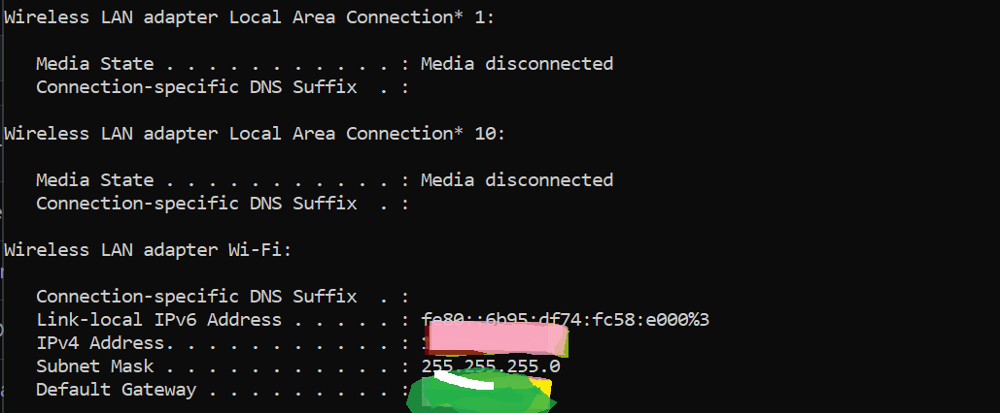
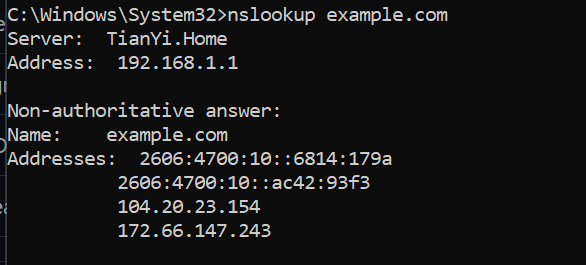
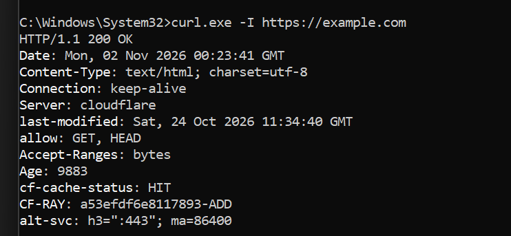

# AWS Student Builders Group — Week 2 Lab

## Networking & IAM Fundamentals

**Name:** Bontu Bekele

**Date Completed:** November 2, 2026

**Track:** Cloud & DevOps

**Lab Type:** Individual Hands-on Exercise

---

## 1. Overview

This repository documents my Week 2 practical exercises as part of the Cloud and DevOps learning track.

The lab focuses on understanding fundamental networking concepts, IP addressing, subnetting, DNS resolution, HTTPS communication, HTTP status codes, and AWS Identity and Access Management (IAM).

### Objectives

* Identify basic network configuration information.
* Understand IPv4 addressing and subnetting.
* Practice DNS resolution.
* Inspect HTTPS responses.
* Understand common HTTP status codes.
* Create and interpret a least-privilege AWS IAM policy.
* Practice identifying and troubleshooting common networking and authorization problems.

## 2. Environment and Tools

| Component           | Description                  |
| ------------------- | ---------------------------- |
| Operating System    | Microsoft Windows            |
| Terminal            | Windows Command Prompt       |
| Browser             | Web Browser                  |
| Networking Commands | ipconfig, nslookup, curl.exe |
| Version Control     | Git and GitHub               |
| IAM Policy Format   | JSON                         |

---

## 3. Tasks and Implementation

### Task 1 — Identify Your Network Information

**Command used:**

```cmd
ipconfig
```

The `ipconfig` command displays the network configuration of the computer, including IP addresses, subnet masks, and default gateways.

**Results:**

| Information         | Result                              |
| ------------------- | ----------------------------------- |
| Operating System    | Microsoft Windows                   |
| Network Adapter     | Wi-Fi                               |
| Local IPv4 Address  | Checked locally; hidden for privacy |
| Subnet Mask         | 255.255.255.0                       |
| Default Gateway     | Checked locally; hidden for privacy |
| IPv4 Classification | Private                             |

**Understanding Private IPv4 Addresses**

Private IPv4 addresses belong to the following ranges:

* 10.0.0.0 – 10.255.255.255
* 172.16.0.0 – 172.31.255.255
* 192.168.0.0 – 192.168.255.255

These addresses are used within private networks and are not directly routable over the public internet.

**Evidence:**



---

### Task 2 — Practice Subnetting

**Starting Network:** `10.0.0.0/24`

**Requirement:** Divide the network into four equal-sized subnets.

#### Calculations

1. IPv4 addresses contain 32 bits.
2. The starting prefix is `/24`.
3. The number of host bits is `32 - 24 = 8`.
4. The starting network contains `2^8 = 256` total addresses.
5. To create four equal-sized subnets, borrow two bits because `2^2 = 4`.
6. The new prefix becomes `/24 + 2 = /26`.
7. Each subnet contains `2^6 = 64` total addresses.
8. The subnet block size is 64, giving network address increments of 64.
9. Conventional usable host addresses are calculated by subtracting the network and broadcast addresses.
10. AWS reserves five IPv4 addresses in each subnet, leaving 59 usable addresses.

#### Subnetting Results

| Subnet | CIDR          | Network Address | Full Address Range    | Conventional Usable Range | Broadcast Address | AWS Usable Addresses |
| ------ | ------------- | --------------- | --------------------- | ------------------------- | ----------------- | -------------------- |
| 1      | 10.0.0.0/26   | 10.0.0.0        | 10.0.0.0–10.0.0.63    | 10.0.0.1–10.0.0.62        | 10.0.0.63         | 59                   |
| 2      | 10.0.0.64/26  | 10.0.0.64       | 10.0.0.64–10.0.0.127  | 10.0.0.65–10.0.0.126      | 10.0.0.127        | 59                   |
| 3      | 10.0.0.128/26 | 10.0.0.128      | 10.0.0.128–10.0.0.191 | 10.0.0.129–10.0.0.190     | 10.0.0.191        | 59                   |
| 4      | 10.0.0.192/26 | 10.0.0.192      | 10.0.0.192–10.0.0.255 | 10.0.0.193–10.0.0.254     | 10.0.0.255        | 59                   |

**AWS Reserved Addresses Example**

For the subnet `10.0.0.0/26`, AWS reserves:

* 10.0.0.0
* 10.0.0.1
* 10.0.0.2
* 10.0.0.3
* 10.0.0.63

Therefore, the AWS-usable range is `10.0.0.4–10.0.0.62`.

---

### Task 3 — Test DNS Resolution

**Command used:**

```cmd
nslookup example.com
```

#### Results

| Information        | Result      |
| ------------------ | ----------- |
| Domain Tested      | example.com |
| DNS Server         | TianYi.Home |
| DNS Server Address | 192.168.1.1 |
| DNS Resolution     | Successful  |

**IPv4 Addresses Returned:**

```text
104.20.23.154
172.66.147.243
```

**IPv6 Addresses Returned:**

```text
2606:4700:10::6814:179a
2606:4700:10::ac42:93f3
```

#### What DNS Does

The Domain Name System (DNS) translates human-readable domain names into IP addresses.

For example, when a user visits `example.com`, DNS helps the computer find the IP address associated with that domain.

The lookup was successful because the command returned IP addresses for the requested domain.

**Evidence:**



---

### Task 4 — Inspect an HTTPS Website

**Website Tested:** https://example.com

**Command used:**

```cmd
curl.exe -I https://example.com
```

The `curl.exe -I` command sends an HTTP HEAD request and displays the response headers without downloading the full page content.

#### Results

| Information   | Result                   |
| ------------- | ------------------------ |
| Website       | https://example.com      |
| HTTP Status   | 200 OK                   |
| Server        | cloudflare               |
| Content-Type  | text/html; charset=utf-8 |
| Connection    | keep-alive               |
| HTTPS Request | Successful               |

**HTTP Status Line:**

```text
HTTP/1.1 200 OK
```

#### What HTTPS Adds to HTTP

HTTPS uses Transport Layer Security (TLS) to provide:

* Encryption of data transmitted between the client and server.
* Authentication of the server through its digital certificate.
* Protection against unauthorized modification of data in transit.

#### Why DNS Resolution Alone Does Not Guarantee a Website Will Load

DNS only translates a domain name into an IP address.

Even when DNS resolution succeeds, other problems may prevent a website from loading, including:

* Network connectivity problems.
* Server unavailability.
* Connection timeouts.
* TLS certificate errors.
* HTTP or application-level errors.

The HTTPS request returned `200 OK`, indicating a successful response from the server.

**Evidence:**



---

### Task 5 — Interpret HTTP Status Codes

| Status Code | Meaning                                                               | Example Situation                                                     |
| ----------- | --------------------------------------------------------------------- | --------------------------------------------------------------------- |
| 200         | OK — the request succeeded.                                           | A page or resource is returned successfully.                          |
| 301         | Moved Permanently — the resource has a permanent new URL.             | A website redirects a resource to a new URL.                          |
| 403         | Forbidden — the server refuses access.                                | The requester does not have permission to access a resource.          |
| 404         | Not Found — the requested resource was not found.                     | The URL points to a page that does not exist.                         |
| 500         | Internal Server Error — the server encountered an unexpected problem. | An application error prevents the server from completing the request. |

#### Difference Between DNS Failure, Connection Timeout, TLS Error, and HTTP Error

**DNS Failure:** The domain name could not be resolved to an IP address.

**Connection Timeout:** The destination did not respond within the allowed time. Possible causes include network connectivity issues, routing problems, firewall rules, or server unavailability.

**TLS Certificate Error:** The secure connection could not be properly validated because of a certificate or other TLS-related problem.

**HTTP Error Response:** The client successfully reached an HTTP server but received an error response such as 403, 404, or 500.

---

### Task 6 — Write a Least-Privilege IAM Policy

A JSON file named `s3-read-policy.json` was created to demonstrate the principle of least privilege in AWS IAM.

The policy allows only the `s3:GetObject` action on objects inside a bucket named `example-bucket`.

**Policy File:** `s3-read-policy.json`

#### Policy Explanation

1. **Which field specifies the permitted action?**

   `Action` specifies the operation that is allowed. In this policy, it is `s3:GetObject`.

2. **Which field specifies the resources?**

   `Resource` specifies the AWS resource to which the permission applies.

3. **Does s3:GetObject allow listing all objects in a bucket?**

   No. Listing objects typically requires the separate `s3:ListBucket` permission.

4. **Why is a narrow permission safer than granting s3:*?**

   Narrow permissions follow the principle of least privilege. They reduce unnecessary access and limit the potential impact of mistakes or compromised credentials.

5. **Why should AWS access keys never be committed to GitHub?**

   Publicly exposed credentials could be copied and misused to access AWS resources or cause unexpected charges.

**Safety Note:** This lab required writing and reviewing the JSON policy only. It was not attached to a live AWS identity.

The completed policy is available in the repository:

[`s3-read-policy.json`](s3-read-policy.json)

---

### Task 7 — Troubleshooting Practice

#### Scenario 1: A domain name does not resolve to an IP address.

**Layer:** DNS

**Explanation:** The domain-to-IP lookup is failing. Check the domain spelling, DNS resolver configuration, and DNS response.

#### Scenario 2: A domain resolves, but the browser connection times out.

**Layer:** Network Connectivity

**Explanation:** DNS is working, but the destination is not responding within the allowed time. Investigate routing, firewall/security rules, port reachability, and server availability.

#### Scenario 3: The browser displays a TLS certificate warning.

**Layer:** TLS

**Explanation:** Investigate certificate validity, hostname matching, expiration, certificate chain, and device date/time.

#### Scenario 4: A website responds with HTTP 404.

**Layer:** HTTP/Application

**Explanation:** The server was reached, but the requested resource was not found. Check the URL, path, and whether the resource exists.

#### Scenario 5: An EC2 application can reach Amazon S3 but receives AccessDenied when reading an object.

**Layer:** IAM/S3 Authorization

**Explanation:** Investigate the IAM identity used by the application, its effective permissions, the object ARN, bucket policies, explicit denies, and relevant encryption-key permissions.

---

## 4. Practical Evidence

The following screenshots document the practical command-line exercises completed during the lab.

| Task                         | Evidence                                                   |
| ---------------------------- | ---------------------------------------------------------- |
| Task 1 – Network Information | [View Screenshot](evidence/task-1-network-information.png) |
| Task 3 – DNS Resolution      | [View Screenshot](evidence/task-3-dns-lookup.png)          |
| Task 4 – HTTPS Inspection    | [View Screenshot](evidence/task-4-https-response.png)      |

The subnetting calculations, HTTP status code interpretations, IAM policy, and troubleshooting exercises are documented directly in this README.

---

## 5. Learning Outcomes

Through this hands-on lab, I gained practical experience in:

* Identifying local network configuration information.
* Understanding private IPv4 addressing.
* Dividing an IPv4 network into equal-sized subnets.
* Understanding AWS subnet address reservations.
* Performing DNS lookups using `nslookup`.
* Inspecting HTTPS response headers using `curl`.
* Understanding common HTTP status codes.
* Writing and interpreting a least-privilege IAM policy.
* Identifying and troubleshooting networking and authorization problems.

---

## 6. Conclusion

The Week 2 Networking and IAM lab provided practical experience with fundamental networking concepts and AWS security principles.

By completing these exercises, I strengthened my understanding of IP addressing, subnetting, DNS resolution, HTTPS communication, HTTP status codes, and IAM permissions.

These concepts provide an important foundation for my continued learning in Cloud Computing and DevOps.

---

